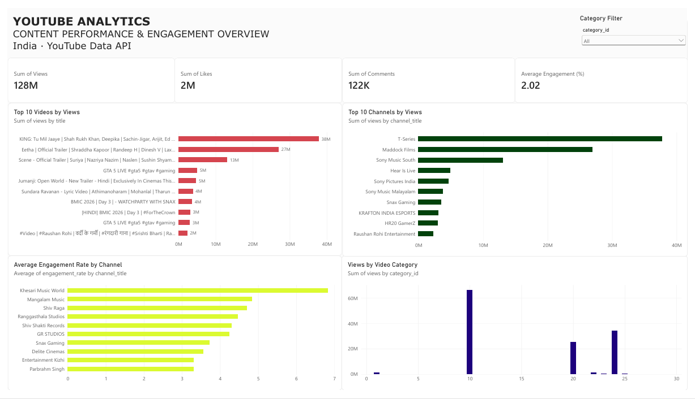

# YouTube Data Engineering Pipeline & Analytics

An end-to-end data engineering project that extracts popular YouTube video data using the YouTube Data API v3, transforms and loads it into a PostgreSQL data warehouse, validates data quality, and visualizes insights using Power BI.

## Project Overview

This project automates the ingestion and analysis of popular YouTube videos in India. It demonstrates an ETL workflow involving API integration, Python-based data processing, relational data modelling, automated validation, and business intelligence reporting.

## Architecture

```text
YouTube Data API v3
        |
        v
Python Data Ingestion
        |
        v
Raw JSON + Processed CSV
        |
        v
PostgreSQL Data Warehouse
        |
        v
Data Quality Validation
        |
        v
Automated Pytest Suite
        |
        v
Power BI Dashboard
```

## Tech Stack

- **Programming:** Python
- **API:** YouTube Data API v3
- **Database:** PostgreSQL
- **Libraries:** Pandas, NumPy, SQLAlchemy, Requests, Psycopg
- **Testing:** Pytest
- **Visualization:** Microsoft Power BI
- **Environment:** Antigravity IDE, Git, GitHub

## ETL Pipeline

1. **Extract:** Fetches up to 50 popular videos in India through the YouTube Data API.
2. **Transform:** Processes video metadata, statistics, categories, durations, and publication details into structured CSV data.
3. **Load:** Loads the data into PostgreSQL staging and warehouse tables.
4. **Validate:** Performs data quality checks for missing values, duplicate records, invalid metrics, and referential integrity.
5. **Test:** Runs automated pipeline tests using Pytest.
6. **Visualize:** Connects Power BI to PostgreSQL to generate analytical reports.

## Database Design

The PostgreSQL warehouse contains:

| Table | Purpose |
|---|---|
| stg_youtube_trending | Raw staging data |
| dim_channel | Channel information |
| dim_video | Video information |
| dim_date | Date dimension |
| fact_video_performance | Video performance metrics |

A SQL view, `mart_video_performance`, supports Power BI reporting.

## Power BI Dashboard

The dashboard includes:

- Total Views
- Total Likes
- Total Comments
- Average Engagement Rate
- Top 10 Videos by Views
- Top 10 Channels by Views
- Engagement Rate by Channel
- Views by Category
- Category-based filtering

## Data Quality & Testing

The project includes automated checks for:

- Missing video IDs and dates
- Negative performance metrics
- Duplicate daily snapshots
- Orphaned dimension references
- Missing channel mappings

**Testing:** 9 automated Pytest cases successfully passed.

## Project Structure

```text
youtube-data-engineering/
│
├── config/
├── data/
│   ├── raw/
│   └── processed/
│
├── database/
│   ├── schema.sql
│   └── test_connection.py
│
├── ingestion/
│   ├── youtube_client.py
│   └── load_warehouse.py
│
├── tests/
│   └── test_pipeline.py
│
├── validation/
│   └── data_quality.py
│
├── reports/
├── requirements.txt
├── run_pipeline.bat
└── README.md
```

## How to Run

### 1. Clone the repository

```bash
git clone https://github.com/himanvidamarla/youtube-data-engineering.git
cd youtube-data-engineering
```

### 2. Create a virtual environment

```bash
python -m venv .venv
.venv\Scripts\activate
```

### 3. Install dependencies

```bash
pip install -r requirements.txt
```

### 4. Configure environment variables

Create a `.env` file in the project root:

```env
DB_HOST=localhost
DB_PORT=5432
DB_NAME=youtube_analytics
DB_USER=postgres
DB_PASSWORD=your_password
YOUTUBE_API_KEY=your_api_key
```

### 5. Set up PostgreSQL

Create the `youtube_analytics` database and execute the SQL statements in `database/schema.sql`.

### 6. Run the pipeline

```bash
run_pipeline.bat
```

This executes ingestion, warehouse loading, data quality validation, and automated tests.

## Future Enhancements

- Cloud deployment using AWS.
- Workflow orchestration using Apache Airflow.
- Historical trend analysis using accumulated daily snapshots.
- Advanced analytics and predictive modelling.
- Automated dashboard refresh.

## Limitations

- The YouTube API retrieves current popular-video data, not historical performance.
- Historical analysis requires collecting snapshots over multiple days.
- The pipeline currently retrieves up to 50 videos per API request.

## Author

**Himanvi Damarla**

[GitHub](https://github.com/himanvidamarla)
